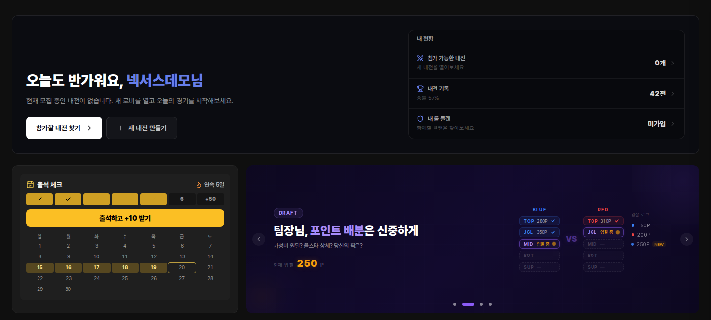
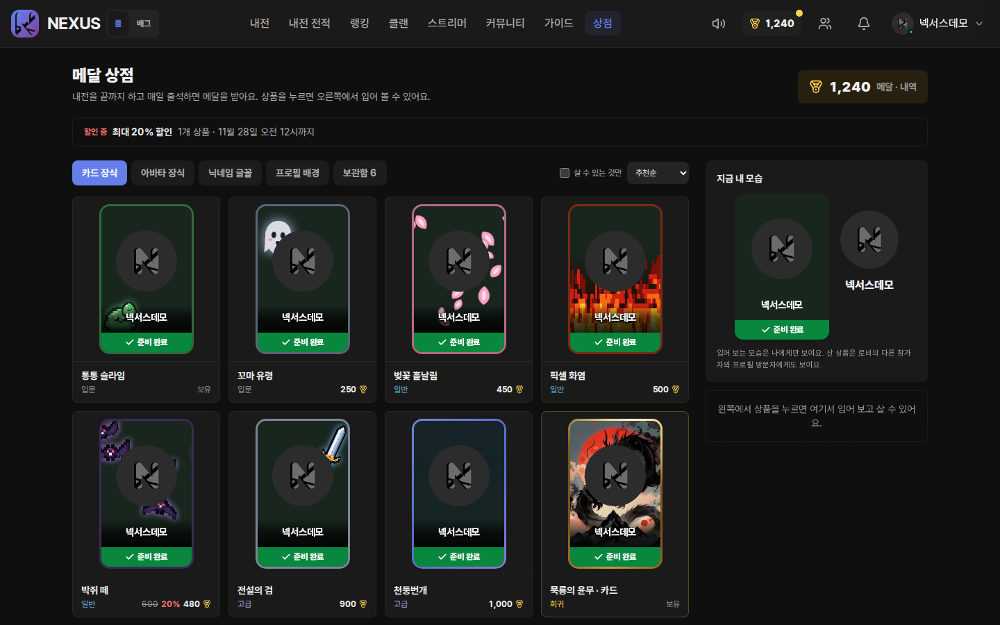
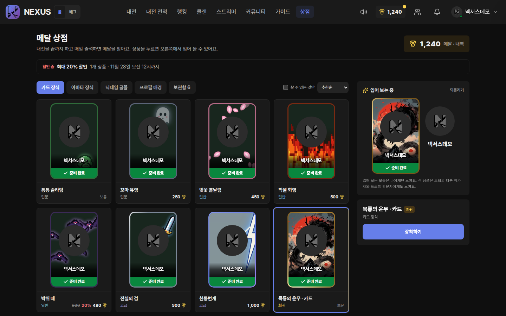
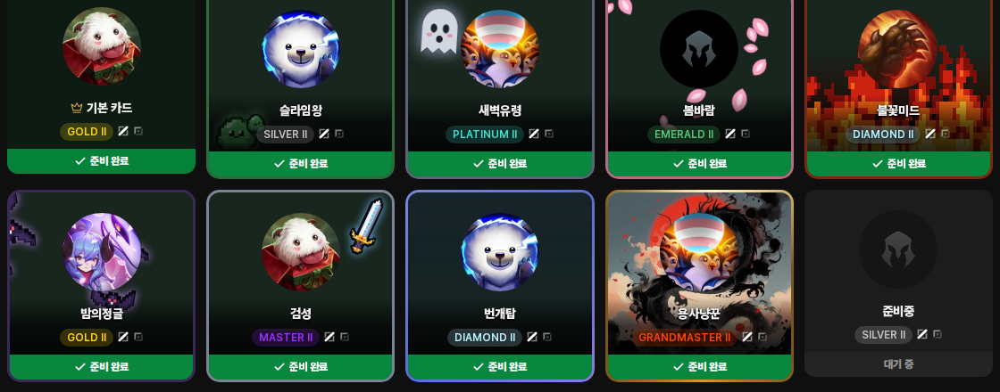
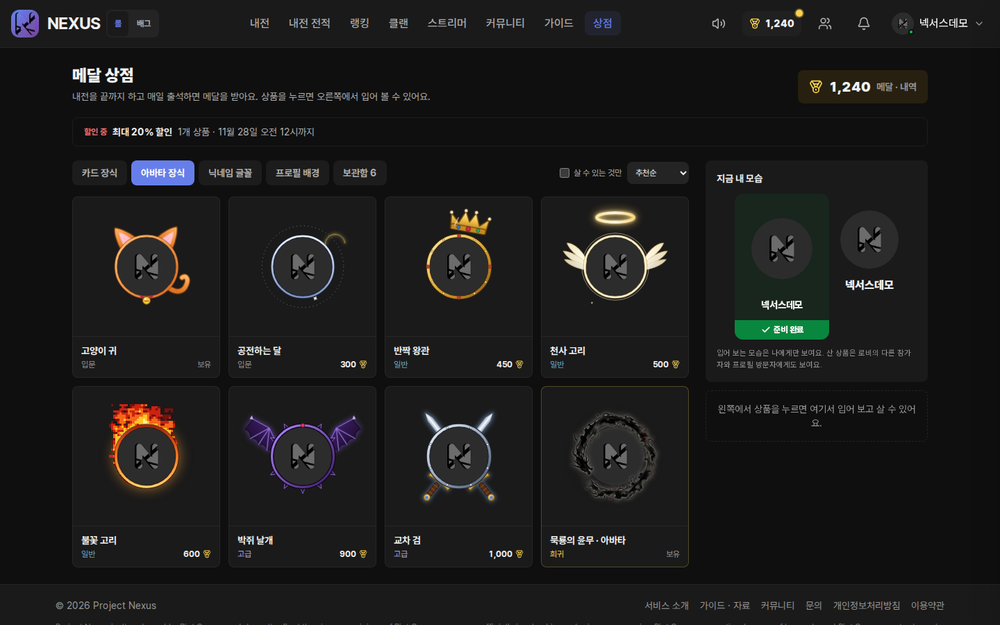
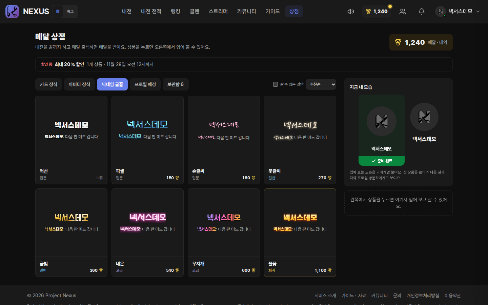
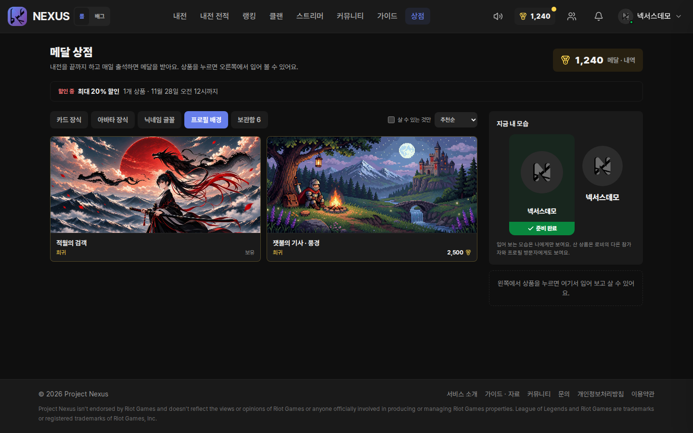

# [업데이트] 메달 상점 오픈 — 출석 체크, 꾸미기, 프로필 배경

내전을 하면 이제 **메달**이 쌓이고, 그 메달로 로비 카드와 프로필을 꾸밀 수 있습니다.

이번 업데이트는 "내전을 끝까지 한 사람에게 돌아가는 것"을 만드는 데서 시작했습니다. 승패와 상관없이 판을 끝까지 함께한 사람이 보상을 받고, 그 보상이 다른 참가자 눈에 보이는 꾸미기로 이어지도록 했습니다.

---

## 메달은 이렇게 받습니다

### 내전 한 판마다

| 항목                         | 메달   |
| ---------------------------- | ------ |
| 내전 완료                    | 10     |
| 승리                         | +10    |
| Riot 기록 확인된 판          | +5     |
| MVP (이긴 팀 1위)            | +5     |
| ACE (진 팀 1위)              | +3     |
| 칭찬을 받을 때마다           | +1     |
| 경기 후 칭찬 창을 마쳤을 때  | +1     |
| 방장으로 내전을 끝까지 진행  | +10    |
| **첫 내전 보너스 (한 번만)** | **50** |

- MVP·ACE는 투표가 아니라 **경기 기록으로 자동** 정해집니다. 자세한 기준은 랭킹·칭찬 공지를 봐 주세요.
- Riot 기록 수집이나 칭찬은 경기가 끝난 뒤 시간이 지나 들어오기도 합니다. 그래도 놓치지 않도록 30분마다 최근 경기를 다시 정산해서, 받아야 할 메달은 나중에라도 들어옵니다. 같은 항목을 두 번 받는 일은 없습니다.

### 하루 상한과 조건

- 경기 메달은 **하루 180개**까지 받을 수 있습니다. (한국 시간 자정 기준) 첫 내전 보너스와 출석 메달은 상한에 들어가지 않습니다.
- 메달이 나오는 경기는 **15분 이상** 진행되고, 참가자 중 **80% 이상이 실제 사람**인 경기입니다. 봇으로 채운 판, 바로 끝낸 판은 메달이 나오지 않습니다.
- 운영진이 무효로 처리한 경기의 메달은 회수됩니다. 첫 내전 보너스가 무효 경기에서 회수됐다면, 다음 정상 경기에서 다시 받습니다.

---

## 출석 체크

홈 화면 히어로 바로 아래에 **출석 체크** 칸이 생겼습니다.

- 하루 한 번 버튼을 누르면 **메달 10개**를 받습니다.
- **7일 연속**으로 출석할 때마다 **보너스 50개**를 더 받습니다. 위쪽 일곱 칸이 지금 몇 일째인지, 보너스까지 며칠 남았는지 보여줍니다.
- 아래 달력에는 이번 달에 출석한 날이 표시됩니다.
- 하루를 빠지면 연속 기록은 처음부터 다시 셉니다.

---

## 메달 상점

헤더 메뉴의 **상점**에서 메달로 꾸미기를 살 수 있습니다. 헤더 오른쪽 메달 칩에서 잔액을 늘 확인할 수 있고, 메달을 받는 순간 「+N」 알림이 뜹니다. 칩을 누르면 최근 내역이 보이고, 거기서 전체 메달 내역 화면으로 넘어갈 수 있습니다.

### 입어 보고 사기

상품을 누르면 오른쪽 **입어 보기** 패널에 내 카드·아바타에 씌운 모습이 바로 나옵니다. 사기 전에 충분히 비교해 보세요.

- 입어 보는 모습은 나에게만 보입니다. 산 상품은 로비의 다른 참가자와 프로필 방문자에게도 보입니다.
- 구매 전에 확인 창이 한 번 뜹니다. 그 사이 할인이 끝나 가격이 바뀌었다면 구매되지 않고 새 가격을 다시 보여 줍니다.
- 산 상품은 바로 장착됩니다. 이미 가진 상품은 「장착하기」로 언제든 바꿔 낄 수 있습니다.
- **보관함** 탭에서 가진 상품만 모아 볼 수 있습니다.

### 할인과 정렬

- 기간 할인이 걸린 상품은 원래 가격에 줄이 그어지고 할인율이 표시됩니다. 상단 띠에서 할인 중인 상품 수와 할인이 끝나는 시각을 확인할 수 있습니다.
- 「살 수 있는 것만」을 켜면 지금 메달로 살 수 있는 상품만 보입니다. 추천순·가격 낮은순·가격 높은순으로 정렬할 수 있습니다.
- 등급은 **입문 · 일반 · 고급 · 희귀** 네 단계입니다. 희귀 상품은 칸이 옅은 금빛으로 구분됩니다.

---

## 꾸미기 네 종류

꾸미기는 네 자리로 나뉘고, 자리마다 보이는 곳이 정해져 있습니다.

### 1. 카드 장식 — 로비 참가자 카드

로비 참가자 카드 위에서 움직이는 장식입니다. 통통 슬라임, 꼬마 유령, 벚꽃, 픽셀 화염, 박쥐 떼, 전설의 검, 천둥번개, 그리고 영상으로 움직이는 희귀 장식 **묵룡의 윤무**, **잿불의 기사**가 있습니다.

| 상품                    | 등급 | 가격  |
| ----------------------- | ---- | ----- |
| 통통 슬라임 · 꼬마 유령 | 입문 | 250   |
| 벚꽃 흩날림             | 일반 | 450   |
| 픽셀 화염               | 일반 | 500   |
| 박쥐 떼                 | 일반 | 600   |
| 전설의 검               | 고급 | 900   |
| 천둥번개                | 고급 | 1,000 |
| 묵룡의 윤무 · 카드      | 희귀 | 1,800 |
| 잿불의 기사 · 카드      | 희귀 | 2,000 |

### 2. 아바타 장식 — 프로필 사진 테두리

프로필 사진을 감싸는 고리와 장식입니다. 로비 카드의 원형 사진, 프로필, 플레이어 호버 카드에 함께 보입니다.

| 상품                    | 등급 | 가격  |
| ----------------------- | ---- | ----- |
| 고양이 귀 · 공전하는 달 | 입문 | 300   |
| 반짝 왕관               | 일반 | 450   |
| 천사 고리               | 일반 | 500   |
| 불꽃 고리               | 일반 | 600   |
| 박쥐 날개               | 고급 | 900   |
| 교차 검                 | 고급 | 1,000 |
| 묵룡의 윤무 · 아바타    | 희귀 | 1,800 |

묵룡의 윤무는 먹으로 그린 용이 아바타 둘레를 한 바퀴씩 천천히 도는 영상 장식입니다.

### 3. 닉네임 글꼴 — 이름이 보이는 모든 곳

로비, 채팅, 전적, 랭킹 등 **내 이름이 보이는 곳 전부**에 적용됩니다.

| 상품        | 등급 | 가격  |
| ----------- | ---- | ----- |
| 먹선 · 픽셀 | 입문 | 150   |
| 손글씨      | 입문 | 180   |
| 붓글씨      | 일반 | 270   |
| 금빛        | 일반 | 360   |
| 네온        | 고급 | 540   |
| 무지개      | 고급 | 600   |
| 불꽃        | 희귀 | 1,100 |

### 4. 프로필 배경 — 움직이는 배너

프로필 맨 위 배너 자리에 들어가는 **움직이는 그림**입니다. 첫 작품은 두 가지입니다.

- **적월의 검객** (희귀 · 2,500) — 붉은 달 아래 바람에 날리는 검객
- **잿불의 기사 · 풍경** (희귀 · 2,500) — 모닥불 앞에서 쉬는 픽셀 기사

프로필 편집 창에서 배경을 **「올린 이미지」와 「가진 배경 장식」 중에서** 고를 수 있습니다. 배경 장식을 고르면 배너가 영상 비율에 맞게 커져서 잘리지 않고 보입니다.

---

## 움직이는 장식이 부담스럽다면

**설정 → 화면 설정 → 꾸미기 효과**에서 다른 사람의 장식이 보이는 방식을 고를 수 있습니다.

- **움직임 그대로** — 기본값
- **멈춘 그림** — 장식은 보이지만 움직이지 않습니다
- **숨기기** — 장식을 아예 보지 않습니다

사양이 낮은 PC나 방송 화면에서 쓰기 좋습니다.

---

## 마무리

상품은 앞으로도 계속 늘려 갈 예정입니다. 갖고 싶은 장식이나 "이건 너무 비싸다/싸다" 같은 의견은 커뮤니티나 문의로 편하게 남겨 주세요.
