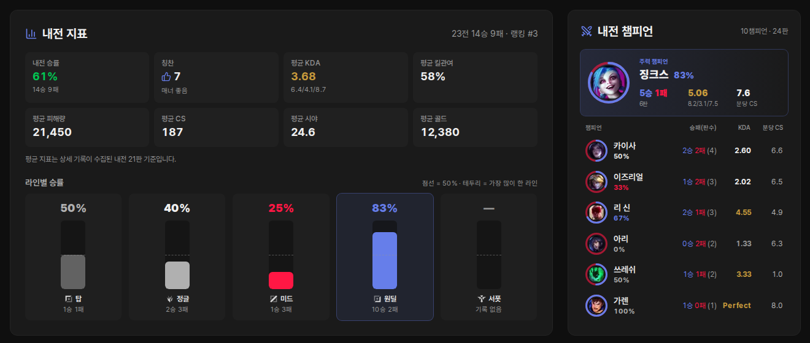
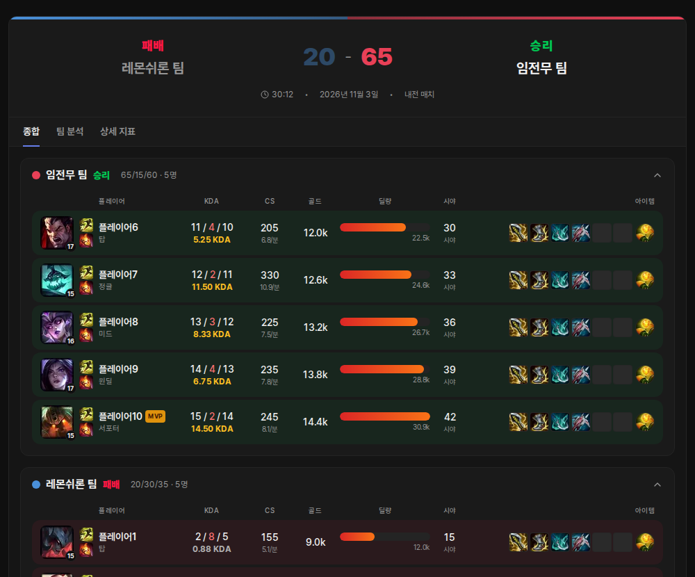
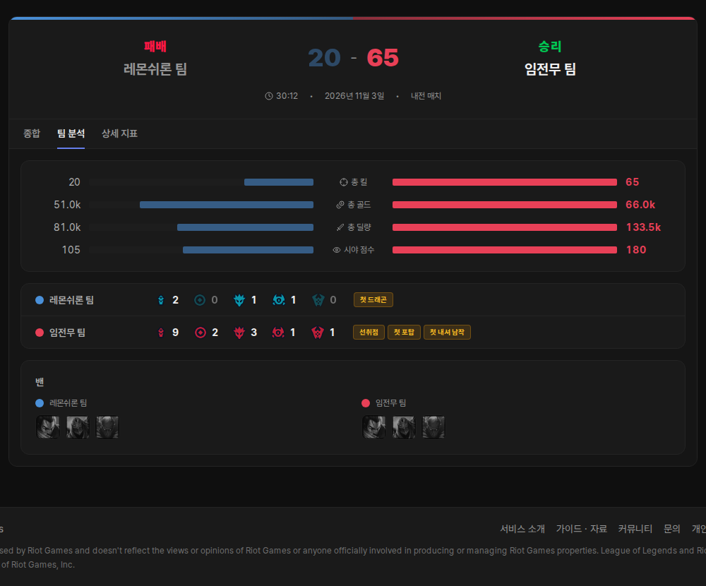

# [업데이트] 내전 전적 개편 — 내전 지표, 내전 챔피언, 경기 상세 탭, 프로필 통합

넥서스 전적을 **"내전에서 나는 어떤 선수인가"**를 보여주는 화면으로 다시 만들었습니다.

지금까지 유저 전적에는 Riot 랭크 게임 기록과 내전 기록이 섞여 있어서, 정작 내전에서 어땠는지는 찾기 어려웠습니다. 이제 넥서스 유저 전적은 **내전 기록만** 보여 주고, 그 기록을 지표·라인·챔피언 단위로 정리해 보여 줍니다.

---

## 프로필과 전적이 한 화면으로

따로 있던 **개인 프로필**과 **넥서스 유저 전적**을 한 화면으로 합쳤습니다. 이름이나 사진을 누르면 프로필 하나에서 소개·연동 계정·내전 기록을 모두 볼 수 있습니다.

- **게임 계정 관리**(Riot 계정, 배그 계정 연결)도 내 프로필 안으로 들어왔습니다.
- 프로필에 **라인별 선호 챔피언**과 **연동된 Riot 계정**이 함께 보입니다.
- 프로필 사진·배경 이미지를 올릴 때 **위치와 크기를 직접 맞춘 뒤** 올릴 수 있습니다. 배경 칸도 넓은 화면 기준 약 3:1로 커졌습니다.
- 랭킹에 오른 사람은 프로필에 **랭킹 순위 배지**가 붙습니다.
- 넥서스 유저의 프로필과 내전 기록은 **로그인한 회원에게만** 보입니다.

---

## 내전 지표 · 내전 챔피언

### 내전 지표 여덟 칸

경매 매물 카드에서 쓰는 것과 같은 여덟 가지 지표를 프로필에서도 봅니다.

> 내전 승률 · 받은 칭찬 · 평균 KDA · 평균 킬관여 · 평균 피해량 · 평균 CS · 평균 시야 · 평균 골드

- 승률과 칭찬은 내전 전체 기준입니다.
- 나머지 평균 지표는 **Riot 상세 기록이 수집된 내전**만 모아 계산합니다. 몇 판 기준인지 아래에 함께 적어 둡니다.

### 라인별 승률

라인마다 승률을 **세로 막대**로 보여 줍니다. 점선이 50%이고, 가장 많이 간 라인에는 테두리가 들어갑니다. 막대 아래에 그 라인의 승패가 함께 표시됩니다.

### 내전 챔피언

내전에서 쓴 챔피언을 **주력 챔피언** 한 명과 목록으로 보여 줍니다.

- 주력 챔피언: 승률 링, 승패(판수), KDA, 분당 CS
- 목록: 챔피언별 승률 링과 승패(판수) · KDA · 분당 CS

---

## 내전 기록 줄

내전 기록 목록의 한 줄도 다시 그렸습니다.

- 판마다 **떨어진 둥근 칸**으로 나뉘고, 이긴 판·진 판은 옅은 바탕색으로 구분합니다.
- 챔피언 옆에 **스펠·룬**, 그리고 **아이템·CS·킬관여**까지 한 줄에 보입니다.
- 어느 목록(프로필, 내전 전적, 방 기록)에서든 같은 모양으로 **펼쳐서** 경기 상세를 볼 수 있습니다.
- 펼친 경기에서 **선수 이름을 누르면 그 선수의 전적**으로 이동합니다.

---

## 경기 상세 — 종합 · 팀 분석 · 상세 지표

내전 한 판을 펼치면 세 개의 탭으로 나뉩니다.

### 종합

- 점수판에 **승리·패배**를 팀 이름 위에 크게 적고, 진 팀은 이름과 점수를 흐리게 처리했습니다.
- 선수별 KDA, CS(분당), 골드, 딜량 막대, 시야, 아이템을 **표 하나**로 정리했습니다.
- 기록으로 정해진 **MVP**가 이름 옆에 표시됩니다.

### 팀 분석

- 총 킬·총 골드·총 딜량·시야 점수를 **가운데 기준 양방향 막대**로 비교합니다.
- 드래곤·전령·바론·공허 유충·포탑 등 **오브젝트를 공식 아이콘**으로 보여 주고, 선취점·첫 포탑 같은 기록을 배지로 붙였습니다.
- 양 팀의 **밴** 목록이 들어갑니다.
- 대회 중계에서 보는 것 같은 **팀 골드 차이 그래프**가 추가되었습니다. 오브젝트를 먹은 시점이 그래프 위에 아이콘으로 표시됩니다.

### 상세 지표

선수별 세부 수치를 더 자세히 볼 수 있는 탭입니다.

---

## 전적이 더 잘 남도록

화면 뒤에서 기록이 빠지던 경우들도 손봤습니다.

- **수집 기준 완화** — 지금까지는 방 로스터 **전원**이 Riot 경기에 있어야 기록을 가져왔습니다. 한 명만 계정이 달라도 통째로 빠졌기 때문에, 이제 **과반수**가 맞으면 수집합니다.
- **로스터와 안 맞는 참가자도 저장** — 넥서스 계정과 연결되지 않은 참가자의 기록도 버리지 않고 저장해 두었다가, 나중에 그 사람이 Riot 계정을 등록하면 자동으로 연결됩니다.
- **방이 정리된 내전도 집계** — 방이 정리된 뒤 상세 화면에서 양 팀이 0명으로 보이던 문제를 고쳤고, 그런 내전도 내전 지표(승패·평균 KDA 등)에 포함됩니다.
- 테스트 봇이 낀 판은 전적과 랭킹에서 제외됩니다.

---

## 마무리

이제 "이 사람이 내전에서 어떤 라인을, 어떤 챔피언으로, 얼마나 잘하는지"를 프로필 한 화면에서 볼 수 있습니다. 경매에서 매물을 볼 때도 같은 지표를 쓰기 때문에, 팀장분들의 판단이 조금 더 쉬워졌으면 합니다.

기록이 비어 보이거나 잘못 잡힌 경기가 있으면 문의로 알려 주세요. 운영진이 해당 경기의 기록 수집을 다시 시도할 수 있습니다.
