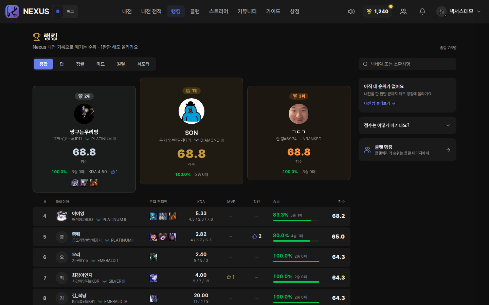
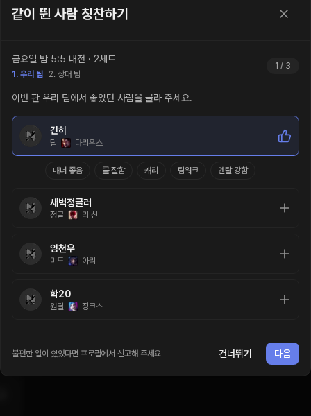

# [업데이트] 랭킹 개편 · 별점 대신 "칭찬" · MVP는 기록으로 자동

랭킹을 누구나 오를 수 있게 바꾸고, 평판 시스템을 **경기 후 칭찬**으로 새로 만들었습니다.

---

## 랭킹

### 1판만 해도 등록

지금까지는 내전을 **10판** 이상 해야 랭킹에 올라갔습니다. 대부분의 분들이 랭킹에 이름조차 없었기 때문에, 이제 **내전 1판만 해도 등록**됩니다.

### 점수 = 보정 승률

1판만 해도 등록되면 "1승 0패 = 승률 100%"인 사람이 맨 위로 올라가는 문제가 생깁니다. 그래서 순위는 단순 승률이 아니라 **보정 승률 점수**로 매깁니다.

> 모든 사람에게 **5판 분량의 50% 승률**을 미리 깔고 계산합니다.
>
> 점수 = (승 + 2.5) ÷ (판수 + 5) × 100

예를 들면 이렇습니다.

| 기록      | 그냥 승률 | 점수 |
| --------- | --------- | ---- |
| 1승 0패   | 100%      | 58.3 |
| 3승 0패   | 100%      | 68.8 |
| 10승 5패  | 66.7%     | 62.5 |
| 20승 10패 | 66.7%     | 64.3 |

몇 판 안 하고 전승한 사람보다, **많이 뛰고 많이 이긴 사람**이 위로 옵니다. 점수가 같으면 판수가 많은 사람이 앞섭니다.

### 라인별 랭킹

**종합 · 탑 · 정글 · 미드 · 원딜 · 서포터** 탭이 생겼습니다. 라인 탭은 내전에서 **그 라인으로 배정되어 뛴 경기**만 모아 순위를 매깁니다. "우리 서버 최고의 서포터"를 찾을 수 있습니다.

### 새 랭킹 화면

랭킹 화면도 새로 그렸습니다.

- **1~3위 시상대** — 2위 · 1위 · 3위 순서로 큰 카드가 놓입니다. 메달 상점에서 산 **카드 장식이 시상대 카드의 바탕**으로 깔리고, 아바타 장식과 닉네임 글꼴·색도 그대로 보입니다. 상위권에 오르면 꾸민 모습이 가장 먼저 보이는 자리입니다.
- **오른쪽 칸** — 내 순위와 「내 자리로」 버튼, 점수 계산법, 클랜 랭킹으로 가는 길이 모여 있습니다. 순위표를 아무리 내려도 오른쪽 칸은 따라옵니다.
- **순위표** — 열을 머리 줄과 맞춰 정리했고, 승률은 막대로 함께 보여 줍니다. **내 줄은 옅은 색으로 강조**됩니다.
- **휴대폰**에서는 내 순위 줄이 화면 아래에 붙어 있고, 누르면 내 자리로 이동합니다.

### 표에 보이는 것

- **주력 챔피언** 3명
- **평균 KDA** (상세 기록이 수집된 내전 기준)
- **MVP 횟수**
- **받은 칭찬** 수
- 승률(승패 + 막대)과 점수

### 검색

오른쪽 위 검색 칸에서 **닉네임이나 소환사명으로 검색**할 수 있습니다. 배그 랭킹에도 닉네임 검색이 들어갔습니다.

### 그 밖에

- 테스트 봇, 그리고 봇이 낀 판은 랭킹과 전적에서 제외됩니다.
- 랭킹에 오른 사람은 프로필에 **순위 배지**가 표시됩니다.
- 클랜끼리의 순위는 각 클랜 페이지에서 볼 수 있습니다.

---

## 칭찬 — 별점 평가를 대신합니다

기존의 별점 평가(실력·태도·소통)는 거의 쓰이지 않았고, 낮은 점수를 주는 것 자체가 부담이라는 의견이 많았습니다. 그래서 **좋았던 사람만 골라 칭찬하는 방식**으로 바꿨습니다.

### 이렇게 동작합니다

1. 내전이 끝나면 **"같이 뛴 사람 칭찬하기"** 창이 뜹니다.
2. 먼저 **우리 팀**, 다음으로 **상대 팀**에서 좋았던 사람을 고릅니다. 한 경기에서 **최대 3명**까지 칭찬할 수 있습니다.
3. 고른 사람에게 태그를 붙일 수 있습니다.
   > 매너 좋음 · 콜 잘함 · 캐리 · 팀워크 · 멘탈 강함
4. 칭찬할 사람이 없으면 **건너뛰기**를 누르면 됩니다.

- 칭찬 창은 경기가 끝난 뒤 **48시간** 동안 열려 있습니다. 바로 못 했더라도 사이트에 다시 들어오면 뜹니다.
- 같은 사람을 한 경기에서 두 번 칭찬할 수 없고, 그 경기에 같이 뛴 사람만 칭찬할 수 있습니다.
- 칭찬은 좋은 것만 남깁니다. **불편한 일이 있었다면 프로필에서 신고**해 주세요.
- 칭찬을 받으면 메달 +1, 칭찬 창을 마치면 메달 +1을 받습니다.

### 어디에 보이나요

받은 칭찬 수와 **가장 많이 받은 태그**가 프로필, 플레이어 호버 카드, 랭킹, 그리고 **경매 매물 카드**에 표시됩니다. 경매에서 "이 사람은 콜을 잘한다" 같은 정보를 볼 수 있게 됩니다.

---

## MVP · ACE는 기록으로 자동 결정

MVP 투표를 없앴습니다. 투표 결과와 실제 기록이 엇갈리면 "기록으론 저 사람이 MVP인데?"라는 말만 나왔기 때문입니다.

이제 **Riot 기록이 수집된 판**은 기록으로 MVP와 ACE를 정합니다.

> 점수 = 킬 × 3 + 어시스트 + 챔피언 피해량 ÷ 1000
>
> **이긴 팀 1위 → MVP**, **진 팀 1위 → ACE**

Riot 기록이 없는 판(코드 없는 사설방 등)은 MVP 없이 둡니다. MVP는 메달 +5, ACE는 메달 +3을 받습니다.

---

## 마무리

랭킹은 "오래, 많이 이긴 사람"이, 평판은 "같이 하고 싶은 사람"이 드러나도록 바꿨습니다. 내전이 끝나면 고마웠던 한 명에게 칭찬 하나 눌러 주세요.
