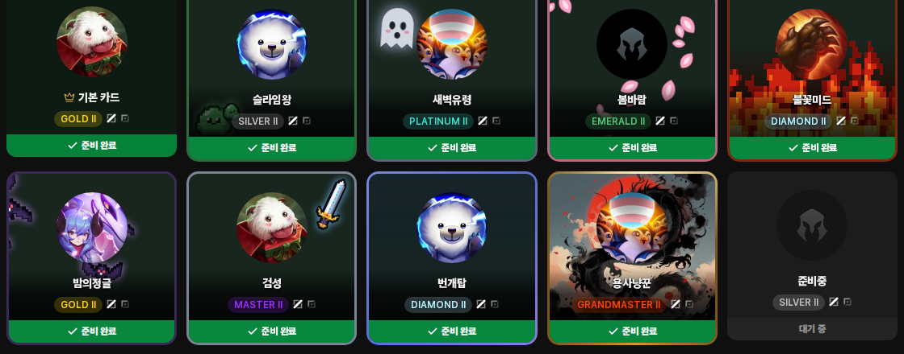
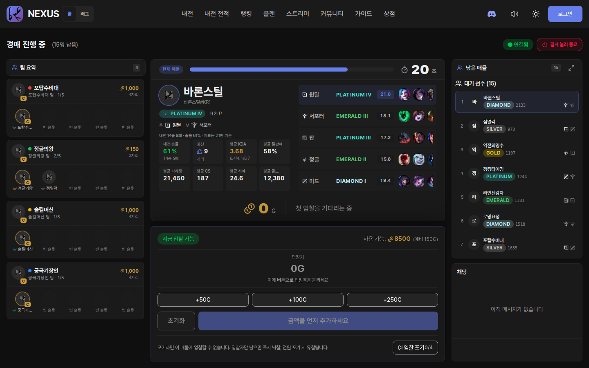
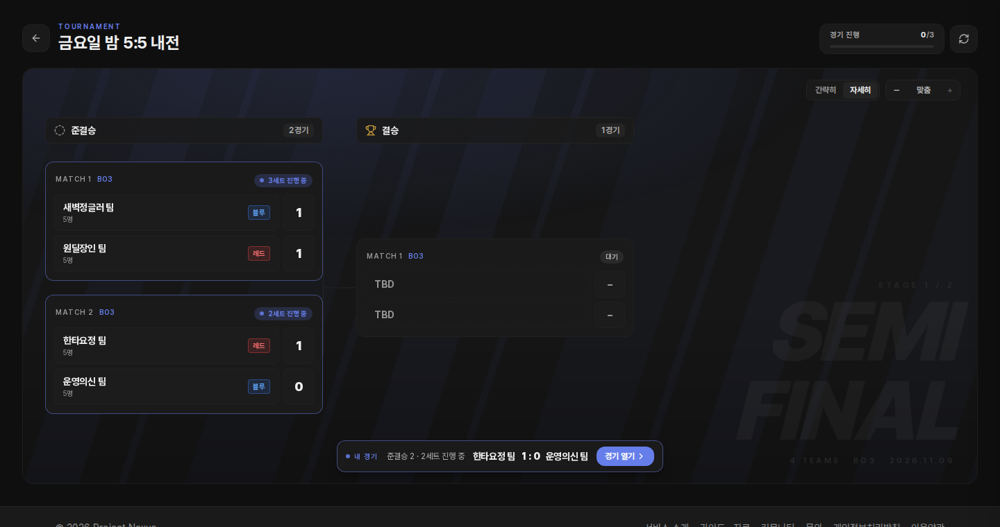

# [업데이트] 로비 · 경매 · 대진표 화면 개편과 진행 편의 개선

내전을 진행하는 화면들을 전반적으로 다시 손봤습니다. 로비는 카드형으로, 경매는 FHD 한 화면에 들어오도록, 대진표는 "지금 내 경기"가 바로 보이도록 바꿨습니다.

---

## 로비

### 초상화 카드 + 오른쪽 방 정보 칸

PC 로비가 **참가자 초상화 카드** 배치로 바뀌었습니다.

- 카드마다 **원형 프로필 사진**, 이름, 티어, 주·부 라인이 보이고, 아래 띠로 **준비 완료 / 대기 중**을 구분합니다.
- 메달 상점에서 산 **카드 장식·아바타 장식**이 카드에 그대로 보입니다.
- 방 정보와 버튼은 **오른쪽 칸**으로 모았습니다.
- **준비** 버튼은 상태에 따라 꽉 찬 색으로 바뀌고, **나가기** 버튼은 실수로 누르지 않게 눈에 띄는 위험 버튼 모양으로 통일했습니다.
- 참가자 이름에 마우스를 올리면 뜨는 **호버 카드**에도 꾸미기와 칭찬 정보가 보입니다.

### 자동 밸런스 화면

자동 밸런스에서 유저 칸을 **카드형**으로 바꿨습니다. 사진, 라인별 티어, 선호 챔피언, 라인 선호 배지를 한 칸에서 볼 수 있습니다.

> 자동 밸런스 버튼이 "서버에 연결되어 있지 않습니다"로 실패하던 문제도 고쳤습니다.

### 방장이 나가면 방 해산 (선택)

방 만들기와 방 설정에 **"방장 퇴장 시 해산"** 옵션이 생겼습니다. (기본은 꺼짐)

- 켜 두면 **대기실 단계에서** 방장이 나갔을 때 방을 넘기지 않고 해산합니다. 직접 나가기, 다른 방 입장, 연결이 끊긴 뒤 자동 퇴장 모두 해당합니다.
- 경기가 시작된 뒤에는 지금처럼 방장이 다른 사람에게 넘어갑니다.
- 남아 있던 참가자에게는 **알림(🔔) + 안내 메시지**가 뜨고 내전 목록으로 이동합니다.

### 디스코드 음성 채널

- **대기실 음성 채널의 인원 제한을 없앴습니다.**
- **팀 음성 채널 정원**을 팀 인원 + 2자리로 늘렸습니다(롤 7자리, 배그 6자리). 관전자나 운영진이 팀 채널에 들어가 인터뷰할 수 있습니다.

### 그 밖에

- 방 인원 표시와 초대 가능 여부를 **선수만** 세도록 통일했습니다. 관전자 때문에 방이 꽉 찬 것처럼 보이던 문제가 사라졌습니다.
- 방장 본인이 막고 있을 때 DM 호출이 "부를 사람 없음"으로 뜨던 문제를 고쳤습니다.
- 방 만들기 창의 토글 칸에서 이름이 세로로 밀리던 문제를 고쳤습니다.

---

## 경매

### FHD 한 화면에

1920×1080 모니터에서 매물 카드가 눌리고 팀 요약이 스크롤되던 문제를 정리했습니다. **채팅은 오른쪽**으로 옮겼습니다.

### 카운트다운은 매물 카드 맨 위에

남은 시간이 **매물 카드 머리 띠**에 큰 숫자와 **줄어드는 막대**로 표시됩니다. 입찰하면서도 시간이 한눈에 들어옵니다.

### 매물 카드에 내전 지표

매물 카드에 해당 선수의 **내전 지표 여덟 칸**이 들어갑니다.

> 내전 승률 · 칭찬 · 평균 KDA · 평균 킬관여 · 평균 피해량 · 평균 CS · 평균 시야 · 평균 골드

오른쪽 라인 줄마다 티어 옆에 **라인별 밸런스 점수**(자동 밸런스 기준)가 표시됩니다. "이 사람이 어느 라인에서 가장 쓸 만한가"를 바로 비교할 수 있습니다.

---

## 역할 선택

- 역할 선택 **제한 시간이 5분**으로 바뀌었습니다.
- 팀장 버튼 문구를 「**팀 역할 확정**」으로 정리했습니다.

---

## 대진표

### 새 대진표 화면

- 상단 **머리글**에 대회 이름과 **경기 진행률**이 보입니다.
- 배경에 현재 단계(준결승·결승 등)가 크게 흐릅니다.
- 경기 카드를 **타일형**으로 바꿨습니다. 다전제면 `BO3` 표시, 세트 스코어, 몇 세트째인지가 함께 보입니다.
- 화면 아래 **「내 경기」 바**에서 지금 내 경기의 스코어를 보고 바로 **경기 열기**로 들어갈 수 있습니다.
- 경기가 끝나는 순간 승리 효과가 나옵니다.
- **간략히 / 자세히** 보기와 확대·축소·맞춤을 고를 수 있습니다.

### 내전 종료는 "길게 눌러서"

내전 종료 버튼이 처음부터 잘 보이는 빨간 버튼으로 바뀌었고, **길게 눌러야 실행**됩니다. 확인 창 없이도 실수로 끝나지 않습니다. 대진표뿐 아니라 경매·스네이크 드래프트·역할 선택 화면의 내전 종료도 같은 방식입니다.

> 상대가 아직 정해지지 않은 대진(TBD)에 우승 트로피가 뜨던 문제도 고쳤습니다.

---

## 운영 공지 팝업

중요한 운영 공지는 이제 **화면 가운데 팝업**으로도 뜹니다.

- 알림(🔔)에도 함께 남습니다.
- 「확인」이나 「자세히 보기」를 누르면 다시 뜨지 않습니다. X로 닫으면 이번 접속에서만 숨깁니다.
- 경매·드래프트·라인 선택·로비·방송 화면에서는 진행을 방해하지 않도록 뜨지 않습니다.

---

## 기타 수정

- 로비·경매처럼 진행 중인 화면에서는 광고를 불러오지 않습니다.
- 모바일에서 메뉴로 이동한 페이지가 스크롤되지 않던 문제를 고쳤습니다.
- 전적 검색 자동완성이 잘리던 문제를 고쳤습니다.
- 링크를 공유할 때 미리보기 이미지가 빠지던 15개 페이지를 고쳤습니다.
