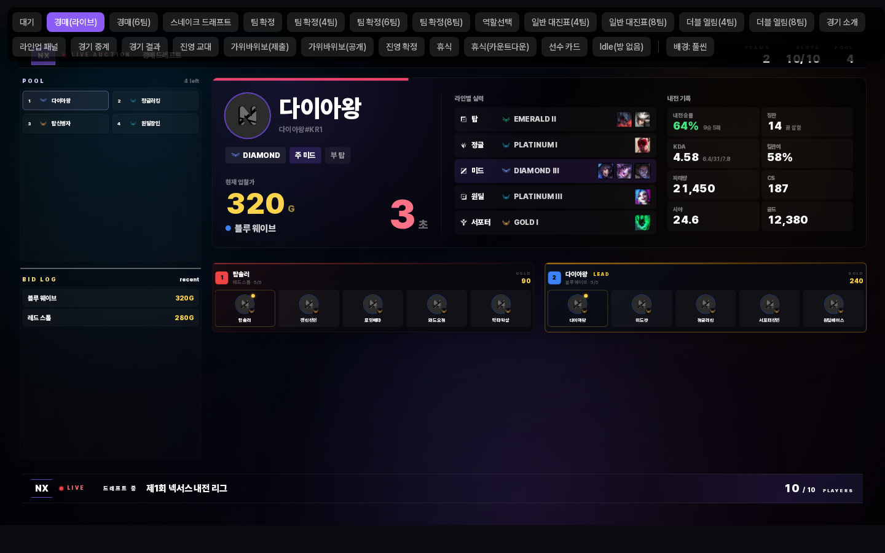
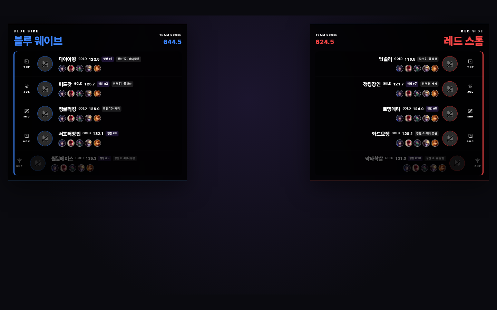
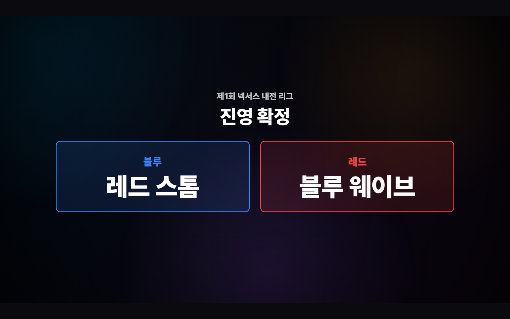
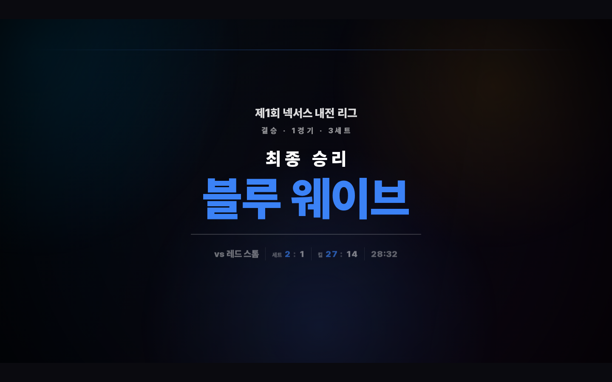

# [업데이트] 방송 오버레이 대개편 — 내 방송에 맞게 꾸미기, 진영 결정 중계, 결과 연출

내전을 방송하는 스트리머·운영자분들을 위해 OBS 오버레이와 방송 조작 패널을 크게 바꿨습니다.

이번 업데이트의 목표는 두 가지입니다. **방송마다 다른 얼굴을 가질 수 있게** 하는 것, 그리고 **방송 화면만 봐도 지금 내전이 어디까지 왔는지** 알 수 있게 하는 것입니다.

---

## 방송 조작 패널

방송 설정에서 여는 **방송 조작 패널**을 방송 장비 느낌의 어두운 콘솔로 다시 만들었습니다.

### 송출 미리보기

지금 OBS로 **나가고 있는 화면을 패널 안에서 그대로** 볼 수 있습니다. 장면을 바꿨을 때 실제로 어떻게 나가는지 OBS를 따로 보지 않아도 확인할 수 있습니다. (미리보기에서는 효과음이 나오지 않습니다.)

### 단계별 장면

방 진행 단계(**모집 → 경매 → 라인 선택 → 경기 → 종료**)에 맞는 장면 버튼이 크게 보이고, 나머지 장면은 "다른 장면"으로 정리됩니다. 지금 띄워야 할 장면을 고민할 필요가 줄어듭니다.

### 즉석 연출

방송 중에 바로 쓸 수 있는 버튼들입니다.

- **결과 다시 보기** — 경기 결과 연출을 처음부터 다시 재생
- **선수 카드 띄우기** — 특정 선수의 카드를 12초 동안 띄우기 / 내리기
- **휴식 카운트다운** — 3 · 5 · 10 · 15분
- **공지 프리셋** — 자주 쓰는 공지 문구를 저장해 두고 한 번에 띄우기

---

## 내 방송에 맞게 꾸미기

**방송 설정**에서 오버레이를 방송인마다 다르게 꾸밀 수 있습니다. 저장하면 송출 중인 오버레이에 **바로 반영**됩니다.

- **색 · 로고 · 문구** — 방송 로고를 올리고 대표 색을 고를 수 있습니다.
- **요소 켜고 끄기 · 크기 · 글꼴**
- **대기 / 휴식 화면 문구**
- **이름 표시 방식**
- **효과음**

### 배경

기본 배경 외에 **움직이는 배경 프리셋** 여러 개가 추가되었고, **직접 만든 이미지를 배경으로 올릴** 수도 있습니다. 기존에 쓰던 배경은 그대로 기본값으로 남겨 두었습니다.

### 장면 전환

장면이 바뀔 때 나오는 **전환 효과**를 고를 수 있고, 설정 화면에서 미리 볼 수 있습니다. 전환용 영상을 직접 올려서 쓸 수도 있습니다.

---

## 경매 · 로스터 화면

경매 장면의 매물 카드에 **라인별 티어와 선호 챔피언, 내전 기록**(승률·칭찬·KDA·킬관여·피해량·CS·시야·골드)이 함께 나옵니다. 시청자도 "이 선수가 왜 비싼지" 바로 볼 수 있습니다.

### 라인 맞대결

자동 밸런스로 2팀을 짠 경우, 로스터 화면이 **같은 라인끼리 마주 보는 맞대결 배치**로 바뀝니다.

- 카드마다 배정 라인 티어(없으면 솔로랭크), 선호 챔피언 3명, 라인 점수
- 양 끝에 팀 이름과 **팀 점수**
- 선수 배지: **랭킹 순위**, **받은 칭찬 수와 대표 태그**
- 교체된 라인 카드는 팀 색으로 번쩍여서 어디가 바뀌었는지 보입니다

3팀 이상일 때는 마주 볼 상대가 없으므로 라인 순서대로 팀 칸에 정리됩니다.

---

## 진영 결정 중계

1세트 진영을 정하는 **팀장 가위바위보**가 이제 방송에도 나옵니다.

1. 양 팀장 제출 대기
2. 손 공개 (비기면 다시)
3. 이긴 팀 팀장이 진영을 고르는 중
4. **블루 / 레드 확정**을 5초 동안 보여 준 뒤 원래 장면으로

다전제에서 2세트부터는 진 팀이 진영을 고르므로, 세트 사이에 **두 팀이 자리를 바꾸는 진영 교대 장면**이 나옵니다.

---

## 결과 연출

경기가 끝나면 결과가 **순서대로** 연출됩니다.

- 승리 팀 발표, 세트 스코어, 킬 스코어, 경기 시간
- Riot 기록이 수집된 판이면 **자동 MVP·ACE**, 진영별 킬·골드·포탑·드래곤·바론·전령, **골드 차이 그래프**까지 보여 줍니다
- 시리즈가 끝나면 **최종 승리** 화면이 나옵니다

놓쳤다면 조작 패널의 「결과 다시 보기」로 처음부터 다시 틀 수 있습니다.

---

## 마무리

방송 오버레이는 설정에서 OBS용 링크를 복사해 브라우저 소스로 넣으면 바로 쓸 수 있습니다. 써 보시고 "이런 장면이 있었으면 좋겠다" 하는 것이 있으면 알려 주세요. 방송하는 분들의 의견을 가장 먼저 반영하겠습니다.
